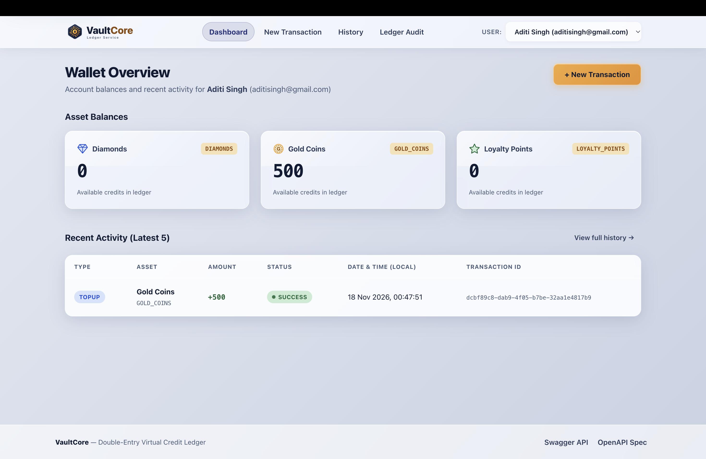
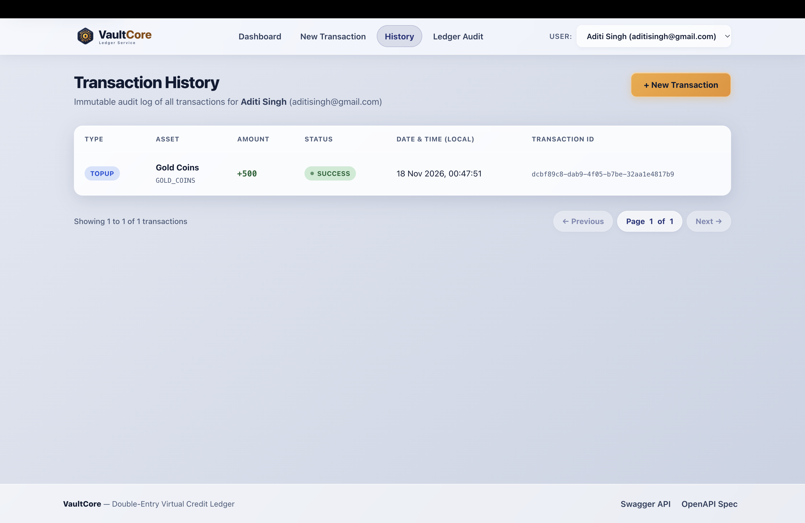
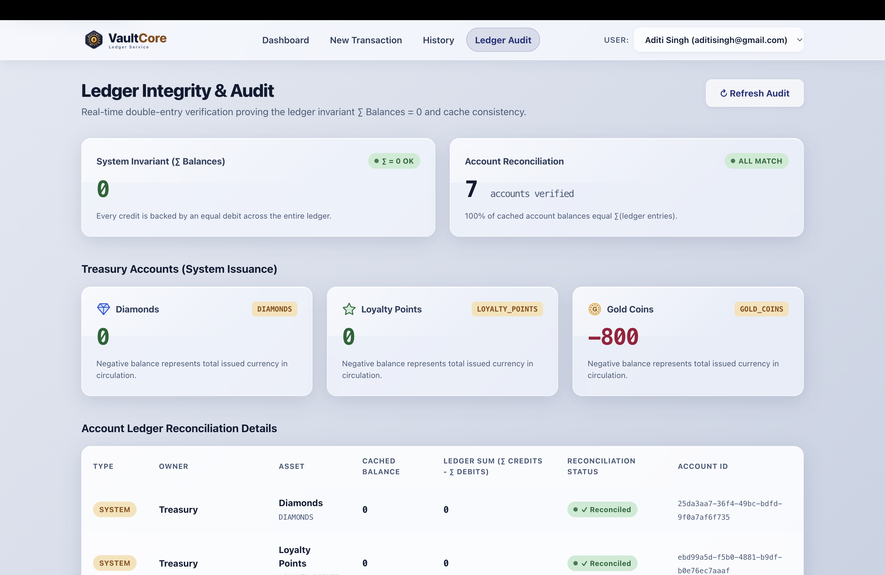

# 🏦 VaultCore

<p align="center">
  
</p>

> A high-performance, double-entry virtual credit ledger service built with **Java 21**, **Spring Boot 4**, and **PostgreSQL 16**. Designed for gaming platforms, loyalty programmes, and internal credits with strict transactional integrity, zero-lost-update concurrency, idempotent execution, and a responsive web UI.

---

## 📌 Highlights

- ⚖️ **Double-Entry Bookkeeping**: Every transaction creates balanced credit and debit ledger entries. The system always balances to zero (`∑ balances == 0`).
- 🔒 **Deadlock-Free Row-Level Locking**: Pessimistic write locks (`SELECT ... FOR UPDATE`) acquired in strict ascending UUID order across all operations (`TOPUP`, `BONUS`, `SPEND`).
- ⚡ **Strict Idempotency**: Fast-path cache lookup, lock-level recheck, and database unique constraints guarantee that duplicate requests return original results with HTTP `200 OK` without applying side-effects twice.
- 🎨 **Server-Rendered Web UI**: Full-featured Thymeleaf UI with a soft-light glassmorphic theme, user switcher, real-time balance cards with count-up animations, transaction forms with client idempotency key generation, paginated history, and a live ledger audit dashboard.
- 🚀 **Offline-First & CDN-Free**: All styles, icons, logos, and scripts are self-contained in the repository with zero external CDN or npm dependencies.
- 🐳 **Production-Ready Docker**: Multi-stage lightweight Alpine build running under a non-root security profile (`appuser`).
- 🧪 **100% Tested**: Comprehensive 55-test test suite covering unit math, integration flows, seeder idempotency, REST APIs, UI controllers, and 20-thread concurrency contention.

---

## 📸 Web UI Preview

| Dashboard (`/`) | New Transaction (`/transactions/new`) |
|:---:|:---:|
| [](Screenshot/Dashboard.png)<br><sub>*Real-time asset balances, active user switcher, and recent activity log.*</sub> | [](Screenshot/New%20Transaction.png)<br><sub>*Interactive execution form with client idempotency key generation.*</sub> |

| History (`/history`) | Ledger Audit (`/audit`) |
|:---:|:---:|
| [](Screenshot/History.png)<br><sub>*Paginated ledger audit log with status badges and transaction details.*</sub> | [](Screenshot/LadgerAudit.png)<br><sub>*Real-time double-entry reconciliation verifying system balance (&sum; = 0).*</sub> |

---

## 📖 Documentation Index

| Guide | Description |
|---|---|
| 🎨 [**Web UI & Identity**](docs/UI.md) | Pages, user flows, theming system, logo design, and browser idempotency lifecycle. |
| 🏛️ [**Architecture**](docs/ARCHITECTURE.md) | System layers, request lifecycles, design rationale, and enhancements over legacy systems. |
| 🗄️ [**Database & Ledger**](docs/DATABASE.md) | Entity schemas, constraints, invariants, audit queries, and seed data. |
| 🔌 [**API Reference**](docs/API.md) | Endpoints, JSON payloads, HTTP status codes, error models, and curl examples. |
| 🛡️ [**Concurrency & Idempotency**](docs/CONCURRENCY_AND_IDEMPOTENCY.md) | Locking hierarchy, deadlock prevention, race recovery, and performance trade-offs. |
| 🧪 [**Testing Strategy**](docs/TESTING.md) | Unit, integration, web slice, UI template, and multithreaded concurrency tests. |
| 📋 [**Implementation Plan**](docs/IMPLEMENTATION_PLAN.md) | Staged milestone roadmap and definitions of done. |
| 📜 [**Commit History Plan**](docs/COMMIT_PLAN.md) | Milestone development commits with exact git command blueprints. |

---

## 🛠️ Technology Stack

| Layer | Technology | Purpose |
|---|---|---|
| **Language** | Java 21 (LTS) | Modern language features, records for immutable DTOs, clean architecture |
| **Framework** | Spring Boot 4.0.2 | Declarative transaction management (`@Transactional`) and Spring Data JPA |
| **Templates** | Thymeleaf 3 | Server-rendered semantic HTML with offline CSS and vanilla JavaScript |
| **Database** | PostgreSQL 16 | ACID transactions, row-level locking (`PESSIMISTIC_WRITE`), unique constraints |
| **API Docs** | SpringDoc OpenAPI 3.0 | Automated OpenAPI 3.0 specification and customized Swagger UI |
| **Testing** | JUnit 5 + AssertJ + H2 | In-memory PostgreSQL compatibility mode test suite (no external dependencies required) |
| **Deployment** | Docker & Docker Compose | Containerized multi-stage build running as a non-root user (`appuser`) |

---

## 🚀 Quick Start

### Option 1: Docker Compose (Recommended)

Run PostgreSQL and the application container with a single command:

```bash
docker compose up --build
```

- **VaultCore Web UI**: `http://localhost:8080/`
- **New Transaction Form**: `http://localhost:8080/transactions/new`
- **Transaction History**: `http://localhost:8080/history`
- **Ledger Audit & Reconciliation**: `http://localhost:8080/audit`
- **Base REST API URL**: `http://localhost:8080/api/v1`
- **Interactive Swagger UI**: `http://localhost:8080/swagger-ui.html`
- **OpenAPI 3.0 Spec**: `http://localhost:8080/v3/api-docs`

---

### Option 2: Run Locally

**Prerequisites**: JDK 21 and a running PostgreSQL 16 instance.

1. Ensure the wrapper script is executable:
   ```bash
   chmod +x gradlew
   ```
2. Create the target PostgreSQL database:
   ```bash
   createdb vaultcore
   ```
3. Start the Spring Boot application:
   ```bash
   ./gradlew bootRun
   ```

---

## 🧪 Running Tests

The test suite runs entirely on an in-memory H2 database in PostgreSQL mode with row-locking support. Neither Docker nor a local PostgreSQL instance is needed.

```bash
# Run all 55 tests (Unit, Integration, Web, UI, Concurrency)
./gradlew test

# Run only UI tests
./gradlew test --tests '*UiControllerTest'

# Run only concurrency contention tests
./gradlew test --tests '*ConcurrencyIntegrationTest'
```

---

## ⚙️ Configuration Reference

All environment variables come with defaults matching the Docker Compose setup:

| Variable | Default | Purpose |
|---|---|---|
| `PORT` | `8080` | Port on which the HTTP server listens |
| `SPRING_DATASOURCE_URL` | `jdbc:postgresql://localhost:5432/vaultcore` | JDBC connection string |
| `SPRING_DATASOURCE_USERNAME` | `postgres` | Database username |
| `SPRING_DATASOURCE_PASSWORD` | `postgres` | Database password |
| `VAULTCORE_SEED_ENABLED` | `true` | Enables or disables automatic reference data seeding on boot |

---

## 🌐 API Overview

### 1. Execute Transaction
`POST /api/v1/transactions`

Executes a `TOPUP`, `BONUS`, or `SPEND` operation.
- Returns **`201 Created`** for new transactions.
- Returns **`200 OK`** for idempotent replays (with exact historical `balanceAfter`).

#### Request Example (`TOPUP`)
```bash
curl -X POST http://localhost:8080/api/v1/transactions \
  -H "Content-Type: application/json" \
  -d '{
    "type": "TOPUP",
    "email": "aditisingh@gmail.com",
    "assetCode": "GOLD_COINS",
    "amount": 100,
    "idempotencyKey": "topup-aditi-001"
  }'
```

#### Response (`201 Created`)
```json
{
  "transactionId": "550e8400-e29b-41d4-a716-446655440000",
  "transactionType": "TOPUP",
  "amount": 100,
  "balanceAfter": 600,
  "status": "SUCCESS",
  "createdAt": "2026-11-16T12:00:00.123456Z"
}
```

---

### 2. Check Wallet Balances
- Single asset: `GET /api/v1/balance?email={email}&assetCode={assetCode}` (also supported at `/api/v1/wallet/balance`)
- All assets: `GET /api/v1/balances?email={email}`

#### Response (`GET /api/v1/balances?email=aditisingh@gmail.com`)
```json
[
  { "assetCode": "GOLD_COINS", "assetName": "Gold Coins", "balance": 600 },
  { "assetCode": "DIAMONDS", "assetName": "Diamonds", "balance": 0 },
  { "assetCode": "LOYALTY_POINTS", "assetName": "Loyalty Points", "balance": 0 }
]
```

---

### 3. Transaction History
`GET /api/v1/transactions?email={email}&page={page}&size={size}`

Returns transactions involving accounts owned by the user, ordered newest first. Optional `page` and `size` parameters provide pagination while maintaining a plain array response format.

#### Response (`200 OK`)
```json
[
  {
    "transactionId": "550e8400-e29b-41d4-a716-446655440000",
    "transactionType": "TOPUP",
    "amount": 100,
    "assetCode": "GOLD_COINS",
    "status": "SUCCESS",
    "createdAt": "2026-11-16T12:00:00.123456Z"
  }
]
```

---

### 4. Ledger Reconciliation Audit
`GET /api/v1/audit/reconciliation`

Verifies that the entire system balances to zero (`∑ balances == 0`), lists Treasury accounts, and proves that 100% of cached balances equal their ledger entry sums.

---

## 🎯 Core Correctness Guarantees

```
Client Request
      │
      ▼
Idempotency Fast-Path Check ────[Found]───► Replay Historical Response (HTTP 200)
      │
      ▼
Resolve Account IDs (No entity loading to prevent stale persistence context)
      │
      ▼
Ordered Row Lock: SELECT ... FOR UPDATE (min(UUID) first, max(UUID) second)
      │
      ▼
Lock-level Idempotency Re-check ────[Found]───► Replay Historical Response (HTTP 200)
      │
      ▼
Balance Validation (USER balance >= amount for SPEND)
      │
      ▼
Execute Double-Entry:
  - Account 1: Cached Balance Update
  - Account 2: Cached Balance Update
  - Insert Transaction (flushed)
  - Insert 2 Ledger Entries (DEBIT + CREDIT with balanceAfter)
      │
      ▼
Commit Transaction & Release Row Locks ───► Return New Response (HTTP 201)
```

1. **Double-Entry Principle**:
   - Every movement creates 1 debit entry and 1 credit entry.
   - For every account: `Balance = ∑ Credits - ∑ Debits`.
   - Across the entire system: `∑ Account Balances = 0`.
2. **Deadlock Elimination**:
   - Every write locks two accounts: the user account and the asset's Treasury account.
   - Locks are strictly acquired in ascending UUID order (`id1.compareTo(id2) < 0`), preventing cyclical locking deadlocks.
3. **Idempotency with True Historical State**:
   - Stored in append-only `ledger_entries.balance_after`.
   - Repeated requests with the same `idempotencyKey` return the historical balance at transaction time, even if subsequent transactions modified the balance.
4. **Clean Failure Boundaries**:
   - Rejections (insufficient funds, invalid assets) roll back completely and never consume the idempotency key, allowing safe client retries.

---

## 🌱 Default Seed Data

Populated on startup by `DataSeeder` through real ledger transactions:

| Asset | Code | User | Role | Opening Balance |
|---|---|---|---|---|
| **Gold Coins** | `GOLD_COINS` | Aditi Singh (`aditisingh@gmail.com`) | User | **500** |
| **Gold Coins** | `GOLD_COINS` | Priya Jha (`priyajha@gmail.com`) | User | **300** |
| **Gold Coins** | `GOLD_COINS` | *Treasury* | System | **-800** |
| **Diamonds** | `DIAMONDS` | Aditi Singh & Priya Jha | User | **0** |
| **Loyalty Points** | `LOYALTY_POINTS` | *Treasury* | System | **0** |

---

## 📝 License

Distributed under the MIT License.
